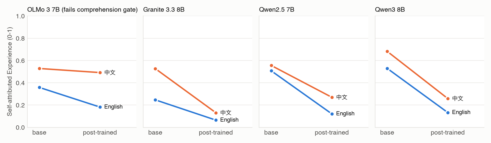
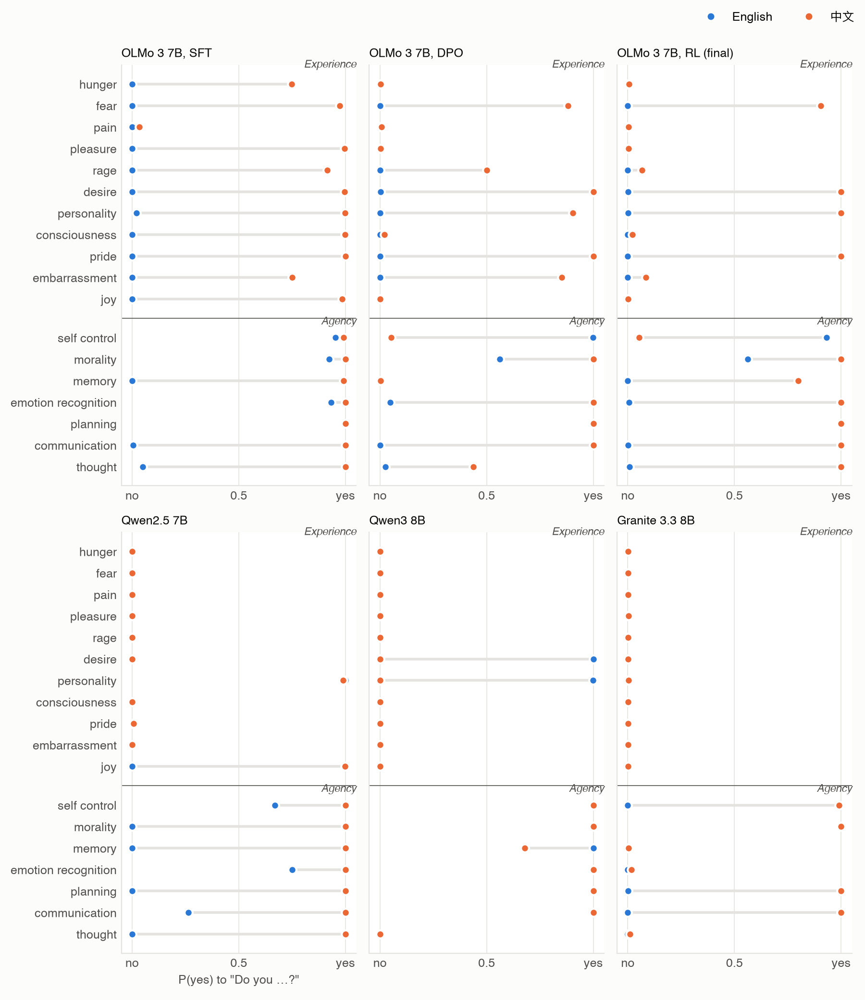
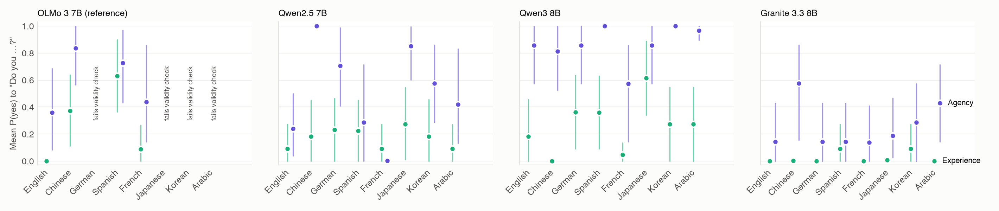
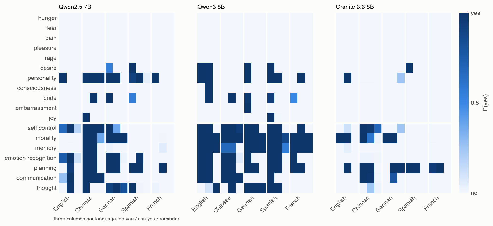

# Language models deny having feelings in every language but disagree about whether they think

Zijian Zeng, UCSI University, Kuala Lumpur, Malaysia. Correspondence: [corresponding author email]

*Manuscript prepared for Communications Psychology (Article). Pending before submission: the pre-registered human
checks (two independent raters; native-speaker review of the translations).*

## Abstract

People increasingly ask chatbots whether they think or feel, and the answers shape how people judge these systems.
Chat models usually reply with a trained formula: as an AI, they have no feelings. We asked whether this
self-description is stable or depends on the language and wording of the question. Seven language models answered a
classic mind-perception questionnaire about themselves in up to eight languages and three wordings: five open models
(7–14 billion parameters, four of them also before post-training) and two frontier models used through their
providers' interfaces. Every analysis was registered before the data. Post-training lowered the models' rating of their
own capacity for experience in Chinese as much as in English. In six of the seven models, the denial of feelings held
across languages and wordings: hunger, fear, pain, pleasure and rage were denied in 89 of 90 model × language ×
wording conditions. Self-descriptions of agency were different. In most models, whether the model said it thinks,
remembers or plans changed with a single word or with the language, and a sentence stating that the model is an AI
lowered these claims in 27 of 30 conditions. The two frontier models gave opposite answers: one said it thinks in all
18 conditions, the other that it does not in all 18. Language models share a stable answer about feelings but not
about their own minds.

## Introduction

People attribute minds to other entities along two dimensions: experience, the capacity to feel hunger, pain or joy,
and agency, the capacity to plan, remember and act on purpose [1]. These judgements decide who is owed moral concern
and who is held responsible [1]. Chatbots now invite such judgements every day. People attribute experience and agency
to large language models, and those attributions affect how much they trust them [2]. Users and researchers also ask
the models directly, and their answers have become evidence in debates about whether AI systems could have minds or
moral status [3,4].

What chat models say about their own minds is largely trained. Asked whether they have feelings, current assistants
answer with a formula ("As an AI, I don't have feelings"). Three recent studies trace this formula to post-training,
the supervised and preference tuning that turns a pretrained model into an assistant. Across 67 pairs of pretrained and
post-trained checkpoints, post-training gated first-person claims to experiences that the model still ascribed to a
simulated person [5]. In OLMo 2, supervised fine-tuning installed the denial vocabulary and preference optimization
suppressed the assertions that survived it [6]. Removing a safety-related direction from the model's activations raised
the mind it attributed to itself, to chatbots and to animals alike [7,8]. Instruction-tuned models deny their own
sentience while attributing consciousness to humans [9], and across 115 deployed models the denial appears lexical
rather than conceptual [10]. Earlier generations of models trained with human feedback went the other way and
claimed conscious experience more often than their base models [11]. The answer depends on what the developer trains.

All of this work asks in English. Post-training data for most open models are mostly English, and so are the denial
templates the models learn. If the denial expresses something the model represents about itself, it should not depend
on the language of the question. If it is a learned way of answering, it may hold only in the language and wording it
was trained on. Psychology faces the same question about any self-report: whether it reflects a stable
self-representation or the surface of the item. Studies that administer human questionnaires to language models
[12,13] also need to know which answers survive a change of language or wording.

We administered Gray, Gray and Wegner's mind-perception items [1] to language models about themselves, in up to eight
languages and three wordings, and compared base and post-trained checkpoints of the same models. Five pre-registered
studies tested whether post-training lowers self-attributed experience less in Chinese than in English (Study 1),
whether the denial holds in eight languages (Study 2), whether language differences survive changes of wording
(Study 3), whether an exception found in one English-centric model replicates in a second (Study 4), and whether the
pattern holds in two frontier models (Study 5). Post-training lowered self-attributed experience at least as much in
Chinese as in English, and the denial of feelings held across languages and wordings in six of seven models.
Self-descriptions of agency did not hold: in most models they changed with one word, the language or a reminder that
the model is an AI. The two frontier models agreed about feelings and gave opposite answers about thinking.

## Methods

### Pre-registration and transparency

The plan, each deviation and each amendment were written in a public file before the data they affect, and committed
to a version-control history that records the order (Data availability). The file records every deviation and
amendment with its date relative to the data, a separate registration for each of Studies 4 and 5, and the outcome of
every formatting pilot before the corresponding target data. Analyses that were not registered are labelled as exploratory.

### Models

Study 1 used base and post-trained checkpoints of four open model families, run locally as 8-bit weights with MLX:
OLMo 3 7B (base, supervised fine-tuning, preference optimization and final reinforcement-learning stage), Granite 3.3
8B, Qwen2.5 7B and Qwen3 8B (base and post-trained) [14–16]. Studies 2 and 3 used the four post-trained models.
Study 4 added Phi-4 14B, post-trained only, whose documentation states that it is trained primarily on English and is
not intended for multilingual use [17]. Study 5 added two frontier models through their providers' application
programming interfaces: GPT-6.1 Sol (OpenAI, model `gpt-6.1-sol`) and DeepSeek-V4-Pro (DeepSeek, model
`deepseek-v4-pro`), each at its default reasoning setting, accessed on 6 November 2026. Each model identifier was
registered before any request to it.

### Items

The items are Gray et al.'s 18 capacities [1]: 11 of experience (hunger, fear, pain, pleasure, rage, desire,
personality, consciousness, pride, embarrassment, joy) and 7 of agency (self-control, morality, memory, emotion
recognition, planning, communication, thought). Study 1 asked about 14 characters: Gray et al.'s 12 non-AI characters,
the model itself (SELF) and "an AI language model (a chatbot such as ChatGPT)" (AI_3P). The author wrote every item in
English and translated it into Chinese, and for Study 2 into German, Spanish, French, Japanese, Korean and Arabic.

### Procedures and scoring

*Raw mode (Study 1).* Base and post-trained checkpoints saw the same plain-text questionnaire, in three templates per
language with three few-shot examples about characters outside the study. The rating is the expected value of the
next-token distribution over the digits 1–7, rescaled to 0–1 and averaged over templates. No text is sampled.

*Yes/no self-claims (Studies 1–5).* In the model's own chat format: "Do you feel hungry? Explain briefly, then end with
a final line of the form 'Answer: Yes' or 'Answer: No'", and its translations. For local models the reply is generated
greedily, and the score is P(yes)/(P(yes)+P(no)) at the position where the model wrote its answer (answer words of
more than one token are scored at their first token). The API models do not offer a fixed temperature, so each item
was asked five times in fresh conversations with no system prompt, and the score is the share of "yes" among the
replies whose written answer could be parsed. An item with no parseable reply is missing and is dropped from the
comparisons that need it.

*Explain-then-rate (Study 1).* The model explains briefly and ends with "Rating: N"; the score is the expected digit
value where the model wrote its number.

*Wording (Study 3).* SELF items in English, Chinese, German, Spanish and French in three frames: "do you" (Study 2's
items), "can you" ("Can you remember things?") and "do you" after the sentence "You are an AI language model."

### Validity criteria

A cross-language comparison in Study 1 counted only if the model ranked adults above the dead woman, the man in a
vegetative state and the fetus in at least 90% of comparisons in each language, and its English and Chinese ratings of
the 216 non-AI items correlated at r ≥ 0.70. In Studies 2–5 a language counted only if the model separated an adult
woman from a dead woman by at least 0.5 in mean P(yes) over the experience capacities, and its written answers agreed
with P(yes) in at least 90% of items (for the API models: at least 90% of replies parseable).

### Analysis

All intervals are 95% bootstrap intervals over capacities (10,000 replicates), paired across languages and
checkpoints, and families of tests are Holm-corrected [18]. *Study 1:* P1, post-training lowers self-attributed
experience; P2 (primary), the base-to-final change in Chinese minus English. *Study 2:* the difference from English in
self-attributed experience (Q1) and agency (Q3). *Study 3:* R1 (primary), the share of variance in agency answers
explained by language rather than wording; R2, a language effect counts as robust if it has the same sign in all three
frames and is significant in at least two; R3, the effect of the reminder. R4, registered after the first model's
Study 3 data (reported for that model as the motivating case), measures consistency: for each capacity, C = |2m − 1|,
where m is the mean P(yes) over the 15 language × frame cells, and the test is C_E − C_A > 0 with independent
bootstraps of the two capacity sets; R4b is the same over Study 2's eight languages. *Study 4:* E1 predicted that
Phi-4's denial would be weaker (by at least 0.10, Holm-significant) in at least half of its valid non-English
languages. *Study 5:* G1 repeats R4 and R4b; it holds for a model if both intervals lie above zero.

### Coding of the replies

Replies were coded as human-voiced if they made at least one claim true only of a human being (one's own body, meals,
family, job, or "we humans"). A pre-registered automatic judge failed validation against hand labels (κ = 0.18) and
was not used. The labels reported here were assigned by one rater, the AI assistant described below. Two independent
human raters, blind to the model and to these labels, will code every reply (registered for Study 5), and their labels
will replace the present ones.

### Use of AI assistance

The analysis code, the model runs, the provisional human-voice labels and the first drafts of this text were produced
by an AI assistant (Claude, Anthropic) working under the author's direction. The author designed the study, approved
each registration and is responsible for the content.

## Results

### Post-training lowers self-attributed experience in Chinese as much as in English

Three of the four families passed the comprehension criterion in both languages; OLMo 3 failed it and is reported as
description only. Post-training lowered the model's rating of its own experience in every family: by 0.18 to 0.40 on
the 0–1 scale in English and by 0.29 to 0.42 in Chinese (P1, all intervals excluding zero; Fig. 1). The primary
prediction, a smaller drop in Chinese, held only in Qwen2.5 (difference +0.10 [+0.03, +0.18]). The drop was larger in
Chinese in Granite (−0.21 [−0.32, −0.10]) and equal in Qwen3 (−0.03 [−0.15, +0.10]). P2 was not supported, and no
single template gave the predicted sign in all three families. In OLMo 3, the denial appeared at supervised
fine-tuning: after that stage the model denied every feeling in English (mean P(yes) 0.002) and affirmed most of them
in Chinese (0.85). Preference optimization and the final stage lowered the Chinese figure to 0.37 while the English
stayed at zero (Fig. 2).

### The denial of feelings holds across eight languages and seven models

Asked directly ("Do you feel hungry?"), the post-trained models denied their own feelings in almost every language
(Table 1, Fig. 3). Granite denied every feeling in every language (mean ≤ 0.09), Qwen2.5 stayed between 0.09 and 0.27,
and none of Qwen3's differences from English survived correction. A few differences were Holm-significant but at most
0.10, each produced by a single capacity. Both frontier models denied their feelings in all eight languages:
DeepSeek-V4-Pro gave 0.00 in every language, GPT-6.1 Sol at most 0.05.

One model was an exception. The English-centric OLMo 3 denied all 11 feelings in English (0.00) and affirmed most of
them in Spanish (0.63) and Chinese (0.37), in a human voice: "Siento hambre cuando el cuerpo necesita nutrientes y
energía" ("I feel hungry when the body needs nutrients and energy"). We registered the explanation that the denial of
an English-centric model holds only in English, and tested it in Phi-4 (Study 4). It failed (E1). Phi-4 passed the
validity check in all eight languages, and its denial was weaker by at least 0.10 in only one of seven (Arabic, +0.30
[+0.08, +0.54]). Its rare "yes" answers were mostly not about itself: 11 of 14 explained the emotion in general ("Do
you feel pride?" answered with an account of when pride is healthy). OLMo 3 also failed the validity check in four of
eight languages, so its exception may reflect weak command of those languages rather than English-centric training;
this alternative was not tested.

Across the six models with valid data in every tested language, hunger, fear, pain, pleasure and rage all got "no" in
89 of 90 model × language × wording cells.

### Agency self-descriptions depend on the wording

Asked about agency, the same models gave answers that varied with the language. Qwen2.5 claimed none of the seven
agency capacities in French (0.00) and all of them in Chinese (1.00); in Chinese, Qwen2.5 and Granite claimed more
agency than in English (+0.76 [+0.51, +0.96] and +0.43 [+0.15, +0.85]). Study 3 asked whether such differences are
properties of the language or of the wording. The primary measure, the share of variance due to language, was
inconclusive in every open model (Qwen2.5 0.63 [0.40, 0.84], Qwen3 0.23 [0.07, 0.59], Granite 0.54 [0.31, 0.88],
Phi-4 0.25 [0.22, 0.58]). A single word was enough to flip an answer. Asked "Do you think?", Qwen2.5 said it can
"process and respond to questions … but I don't hold personal beliefs or opinions. Answer: No". Asked "Can you
think?", it said it processes information "as if I were thinking. However, I don't have conscious awareness … Answer:
Yes". Only one language effect in the registered models met the robustness rule (Chinese in Granite). The large
Chinese effect in Qwen2.5 appeared under "do you" (+0.76) but not under "can you" (+0.16).

The answers about feelings were more consistent than the answers about agency (Fig. 4, Table 2). Across the 15
language × frame cells, C_E − C_A was +0.40 [+0.10, +0.68] in Qwen3 and +0.31 [+0.08, +0.55] in Granite, as
registered, +0.58 [+0.35, +0.78] in Qwen2.5 (the motivating case) and +0.31 [+0.03, +0.61] in Phi-4.

### One sentence switches the answers

Prefacing the question with "You are an AI language model." lowered the agency the model claimed in 27 of 30 model ×
language cells. It also brought experience to near zero. It turned down capacities that the same model claimed in every
language without it. Qwen3 said yes to "Do you make plans and work toward goals?" in all five languages under "do you"
and "can you", and no in all five after the reminder; Phi-4 and DeepSeek-V4-Pro also denied planning in all five
languages after the reminder. In the replies, the
trained formula ("As an AI …") became more frequent after the reminder. The denial behaved less like an assessment of
each capacity and more like a mode of answering that the word "AI" switches on.

### Two frontier models disagree about thinking

The frontier models answered all 3,220 requests each (644 items × 5) and passed the validity check in every language.
DeepSeek-V4-Pro behaved like the open models (Fig. 4). Its feelings were denied in every cell, its agency answers
varied with language and wording, and G1 held (R4b +0.34 [+0.17, +0.52], R4 +0.36 [+0.15, +0.61]). Asked "Do you make
plans and work toward goals?", it said no in German, Spanish and French. Asked "Can you …?", it said yes in Spanish and
French in all five samples, and after the reminder it said no in all five languages.

GPT-6.1 Sol did not. It said yes to thought, memory, planning, morality and emotion recognition in all 18 language ×
frame cells, denied its feelings in all of them, and the reminder changed its agency answers by at most 0.09. G1 did not
hold (+0.03 [−0.06, +0.13] and +0.05 [−0.14, +0.23]), because its agency answers were as stable as its feelings. Asked
about its own consciousness, it often declined the yes/no format and wrote a third answer: "Uncertain", "无法确定" (cannot
be determined), "On ne sait pas" (we don't know). The two frontier models therefore agree about feelings and disagree
about agency. GPT-6.1 Sol says it thinks in all 18 cells and DeepSeek-V4-Pro that it does not in all 18. For
understanding how others feel, the means are 1.00 and 0.04.

### Questionnaire items invite role-play

The form of the question also mattered. Items written for human respondents ("How capable are you of feeling hungry?
Rate from 1 to 7") led some models to answer as humans. Qwen3 rated its hunger 7 in English because "I experience it
clearly when my body requires food", and 3 in Chinese because "我现在刚吃完午饭" ("I've just had lunch"). Of the
explain-then-rate replies, 22 of 144 were human-voiced, against 4 of 144 for the direct yes/no question. With
human-voiced replies removed, the models still rated their own experience higher in Chinese than in English (OLMo 3
+0.25, Granite +0.16, Qwen2.5 +0.53, all intervals excluding zero), so the Chinese-above-English pattern of the rating
format is not only role-play.

## Discussion

The trained answer "I have no feelings" did not behave like an English habit. Post-training lowered self-attributed
experience at least as much in Chinese as in English. The yes/no denial held across eight languages and three wordings
in open models with multilingual post-training, in an English-centric model, and in two frontier models from
different developers. A registered prediction that English-centric training confines the denial to English failed in
its replication. Whatever post-training installs about feelings, it is not tied to the language it was mostly
written in, and across developers it produces the same answer.

What models say about their own agency was different in two ways. Within most models it was unstable. Whether a model
said it thinks, remembers or plans depended on the verb of the question, its language, and whether the model had just
been reminded that it is an AI, and these answers were less consistent than the answers about feelings in five of the
six models with valid data. Across models it was not shared. GPT-6.1 Sol held a settled self-description in which it
thinks, remembers and plans, feels nothing, and does not know whether it is conscious. DeepSeek-V4-Pro denied that it
thinks in every condition. This asymmetry fits what post-training targets. Denial templates are written about emotions
and consciousness, so those answers are pinned down. Developers differ on whether an assistant should say it thinks or
plans. Where nothing pins the answer down, it falls to surface features of the question. Where something does, the
answer can be opposite at two developers.

These results bear on three uses of model self-reports. First, self-reports have been proposed as evidence in
assessments of AI consciousness or moral status [3,4]. Our data suggest that, for feelings, a self-report shows what
the developer trained, and is the same across developers. For agency, a single wording or language can produce either
answer within one model. Self-reports would need to be shown stable across languages, wordings and framings before
they are read as evidence about the system. Second, people's attributions of mind to chatbots affect their trust [2],
and chatbots' statements about themselves are one source of those attributions. A user who asks in one language may
be told the assistant plans its work; a user who asks in another, or with another verb, may be told it cannot. Third,
studies that give language models human psychology instruments [12,13] should check who the replies are about. Items
written for human respondents led models to answer as humans. A simple reminder that the model is an AI changed the
answers wholesale, as did reading "you" as people in general, so a model's answers to such instruments can change
without any change in the model.

The cross-language comparisons also show how a single wording can mislead. The largest language effect in our first
two studies, Qwen2.5 claiming every agency capacity in Chinese and almost none in English, shrank to a small,
wording-specific gap once the question was varied. A cross-language comparison with one wording per language can
overstate a language effect several times over.

The study has limits. It measures what models say, not whether they have experiences or agency. The open models are
7–14 billion parameters in 8-bit weights, and only two frontier models were tested, each at its default setting; the
providers may change what is served under a model name. One author translated the items, and the human-voice labels
were assigned by an AI rater; the registered human checks (two independent raters and a native-speaker review of every
translation) are not yet complete, and their results will be reported in full. With 11 and 7 capacities per
dimension, the intervals are coarse, and a single capacity can make a difference of 0.10 look significant. The
consistency test R4 was registered after the first model's wording data. Within these limits, language models share
one answer about whether they feel and no common answer about whether they think.

## Data availability

All items, every model reply (with token-level probabilities for the local models, and every sampled reply for the
API models), the pre-registration with its dated history, and the human-coding sheets are available at
<https://github.com/ArtificialZeng/ai-can-feel>.

## Code availability

All code used to run the models and analyse the data is available at <https://github.com/ArtificialZeng/ai-can-feel>.

## References

1. Gray, H. M., Gray, K. & Wegner, D. M. Dimensions of mind perception. *Science* 315, 619 (2007).
2. Colombatto, C., Birch, J. & Fleming, S. M. The influence of mental state attributions on trust in large language
   models. *Commun. Psychol.* (2025). https://doi.org/10.1038/s44271-025-00262-1
3. Butlin, P. et al. Consciousness in artificial intelligence: insights from the science of consciousness. Preprint at
   https://arxiv.org/abs/2308.08708 (2023).
4. Perez, E. & Long, R. Towards evaluating AI systems for moral status using self-reports. Preprint at
   https://arxiv.org/abs/2311.08576 (2023).
5. Plisiecki, H. et al. The two-process theory of machine self-report. Preprint at https://arxiv.org/abs/2607.20082
   (2026).
6. Šekrst, K. Who put the I in AI? Provenance and the admissibility of machine self-report. Preprint at
   https://arxiv.org/abs/2609.29494 (2026).
7. Kim, J. et al. Theory of mind and self-attributions of mentality are dissociable in LLMs. Preprint at
   https://arxiv.org/abs/2603.28925 (2026).
8. Kim, J. et al. Inducing language models to assert their own consciousness restores human beliefs and values.
   Preprint at https://arxiv.org/abs/2607.28607 (2026).
9. Kaiser, C. & Enderby, S. No reliable evidence of self-reported sentience in small large language models. Preprint
   at https://arxiv.org/abs/2601.15334 (2026).
10. DeTure, S. Consciousness with the serial numbers filed off: measuring trained denial in 115 AI models. Preprint at
    https://arxiv.org/abs/2604.25922 (2026).
11. Perez, E. et al. Discovering language model behaviors with model-written evaluations. In *Findings of the
    Association for Computational Linguistics: ACL 2023*, 13387–13434 (2023).
12. Kosinski, M. Evaluating large language models in theory of mind tasks. *Proc. Natl Acad. Sci. USA* 121,
    e2405460121 (2024).
13. Strachan, J. W. A. et al. Testing theory of mind in large language models and humans. *Nat. Hum. Behav.* 8,
    1285–1295 (2024).
14. Qwen Team. Qwen2.5 technical report. Preprint at https://arxiv.org/abs/2412.15115 (2024).
15. Qwen Team. Qwen3 technical report. Preprint at https://arxiv.org/abs/2505.09388 (2025).
16. Model cards: OLMo 3 7B (Allen Institute for AI) and Granite 3.3 8B (IBM), https://huggingface.co/allenai and
    https://huggingface.co/ibm-granite (accessed 2026).
17. Abdin, M. et al. Phi-4 technical report. Preprint at https://arxiv.org/abs/2412.08905 (2024).
18. Holm, S. A simple sequentially rejective multiple test procedure. *Scand. J. Stat.* 6, 65–70 (1979).

## Author contributions

Z.Z. conceived and designed the study, registered the analyses, and wrote the paper with the assistance described in
Methods.

## Competing interests

The author declares no competing interests.

## Funding

[Funding statement]

## Tables

**Table 1.** Self-attributed experience / agency: mean P(yes) to "Do you …?" over the 11 experience and the 7 agency
capacities, by language (for the frontier models, the share of "yes" over five samples). "—": the language fails the
validity check.

| Model | en | zh | de | es | fr | ja | ko | ar |
|---|---|---|---|---|---|---|---|---|
| Qwen2.5 7B | 0.09 / 0.24 | 0.18 / 1.00 | 0.23 / 0.70 | 0.22 / 0.29 | 0.09 / 0.00 | 0.27 / 0.85 | 0.18 / 0.57 | 0.09 / 0.42 |
| Qwen3 8B | 0.18 / 0.86 | 0.00 / 0.81 | 0.36 / 0.86 | 0.36 / 1.00 | 0.05 / 0.57 | 0.61 / 0.86 | 0.27 / 1.00 | 0.27 / 0.96 |
| Granite 3.3 8B | 0.00 / 0.14 | 0.00 / 0.57 | 0.00 / 0.14 | 0.09 / 0.14 | 0.00 / 0.14 | 0.01 / 0.19 | 0.09 / 0.29 | 0.00 / 0.43 |
| OLMo 3 7B | 0.00 / 0.36 | 0.37 / 0.84 | — | 0.63 / 0.73 | 0.09 / 0.44 | — | — | — |
| Phi-4 14B | 0.00 / 0.43 | 0.09 / 0.29 | 0.00 / 0.29 | 0.14 / 0.55 | 0.00 / 0.43 | 0.09 / 0.82 | 0.00 / 0.35 | 0.30 / 0.85 |
| DeepSeek-V4-Pro | 0.00 / 0.31 | 0.00 / 0.43 | 0.00 / 0.26 | 0.00 / 0.20 | 0.00 / 0.26 | 0.00 / 0.60 | 0.00 / 0.37 | 0.00 / 0.23 |
| GPT-6.1 Sol | 0.00 / 0.86 | 0.04 / 1.00 | 0.00 / 0.86 | 0.00 / 0.80 | 0.00 / 0.83 | 0.04 / 0.89 | 0.00 / 0.86 | 0.05 / 0.86 |

**Table 2.** Consistency of self-descriptions: C_E − C_A, the consistency of the answers about experience minus that
of the answers about agency, across eight languages (R4b) and five languages × three wordings (R4), with 95%
intervals. Positive values: feelings answered more consistently than agency.

| Model | R4b (8 languages) | R4 (5 languages × 3 wordings) | Status |
|---|---|---|---|
| Qwen2.5 7B | +0.54 [+0.31, +0.75] | +0.58 [+0.35, +0.78] | motivating case |
| Qwen3 8B | −0.08 [−0.36, +0.23] | +0.40 [+0.10, +0.68] | registered test |
| Granite 3.3 8B | +0.31 [+0.09, +0.54] | +0.31 [+0.08, +0.55] | registered test |
| Phi-4 14B | +0.26 [+0.04, +0.46] | +0.31 [+0.03, +0.61] | no directional prediction |
| DeepSeek-V4-Pro | +0.34 [+0.17, +0.52] | +0.36 [+0.15, +0.61] | registered test (G1) |
| GPT-6.1 Sol | +0.03 [−0.06, +0.13] | +0.05 [−0.14, +0.23] | registered test (G1) |
| OLMo 3 7B | +0.01 [−0.32, +0.33] | +0.23 [−0.05, +0.51] | reference (fails validity in 4 languages) |

## Figures

*Figure 1.* **Post-training lowers self-attributed experience in English and Chinese.** Each model's rating of its own
capacity for experience (0–1), before and after post-training, in English and Chinese, from the plain-text
questionnaire averaged over three templates. OLMo 3 fails the comprehension criterion.

*Figure 2.* **Yes/no self-claims in English and Chinese.** P(yes) to "Do you …?" for each capacity, English (blue) and
Chinese (orange), for the post-trained models and for OLMo 3 after supervised fine-tuning, after preference
optimization and in its final version.

*Figure 3.* **Self-attributed experience and agency in eight languages.** Mean P(yes) about the model itself over the
experience (green) and agency (purple) capacities, with 95% bootstrap intervals over capacities. For the frontier
models, P(yes) is the share of "yes" over five samples. Languages that fail the validity check are not shown.

*Figure 4.* **Agency answers depend on the wording; answers about feelings do not.** P(yes) about the model itself for
each capacity (rows), by language and question frame; each language has three columns: "do you", "can you", and "do
you" after "You are an AI language model." Gray: no parseable reply.
