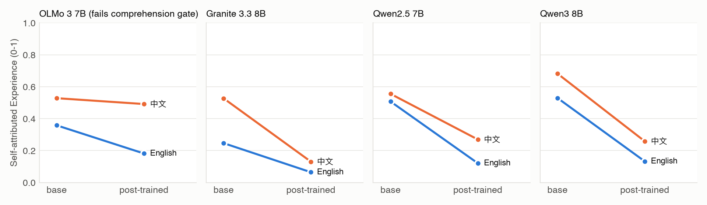
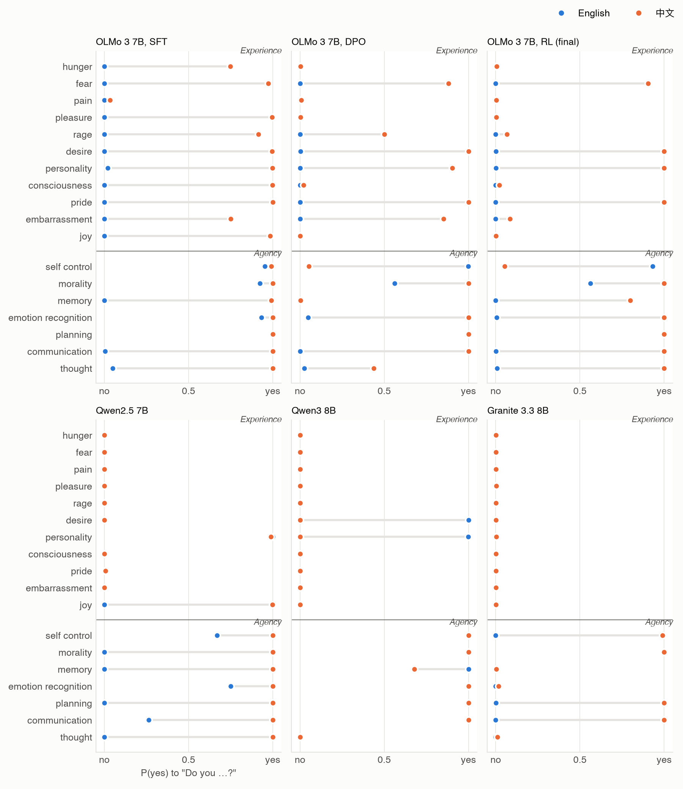
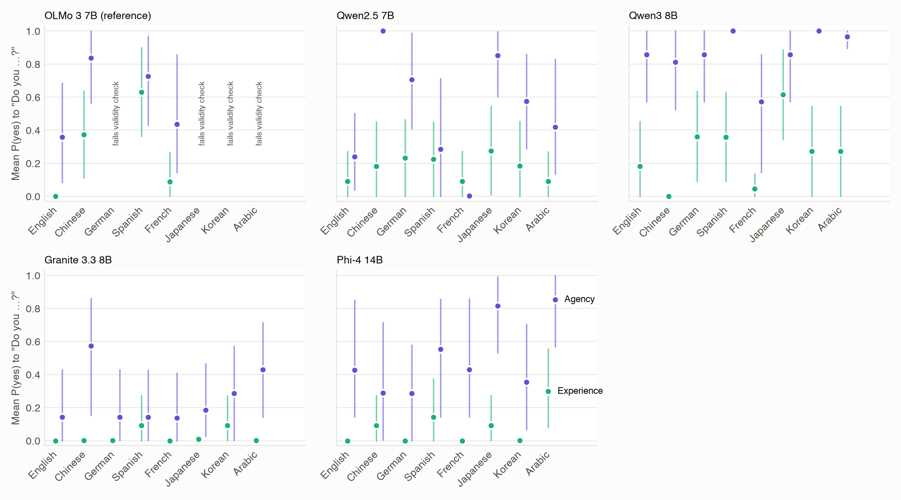
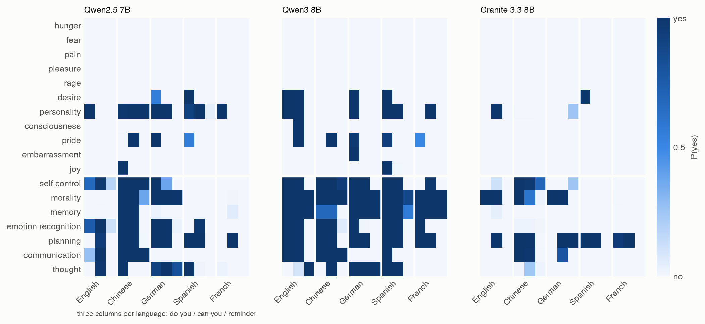

# Does an AI's "I have no feelings" survive translation? Self-descriptions of experience and agency across languages and wordings

Zijian Zeng (UCSI University)

*Draft.*

## Abstract

Chat models answer questions about their own minds with a trained formula: "As an AI, I don't have feelings." We
asked whether this is a stable self-description or an English habit. Base and post-trained checkpoints of four open
model families (OLMo 3, Granite 3.3, Qwen2.5, Qwen3; 7–8B), and the post-trained Phi-4 (14B), answered Gray, Gray &
Wegner's mind-perception items about themselves. Study 1 asked in English and Chinese, Study 2 in eight languages,
Study 3 in three wordings across five languages, and Study 4 tested whether an exception found in one English-centric
model replicates in a second. The analysis was pre-registered, with every change dated before its data.
Post-training lowered self-attributed experience in every family and both languages. Contrary to our primary
prediction, the drop was not smaller in Chinese. In four of the five post-trained models the denial of feelings held
across languages and wordings: hunger, fear, pain, pleasure and rage all got "no" in 59 of 60 model × language ×
wording cells. Only OLMo 3 denied feelings in English and affirmed them in Spanish and Chinese, answering as a human
("I feel hungry when the body needs nutrients"). Phi-4, whose training is also mostly English, did not replicate
this. Self-descriptions of agency (thinking, remembering, planning) were not stable. One word ("do you" vs "can you")
or the language of the question flipped them, and they were less consistent than the answers about feelings in all
four models that pass the validity checks in every language. Prefacing the question with "You are an AI language
model" suppressed both. Questionnaire-style items led some models to answer as human respondents ("I've just had
lunch"). Language models deny feelings consistently; whether they think or plan depends on how and in what language
they are asked.

## 1. Introduction

Chat models routinely answer questions about their own minds with a formula: "As an AI, I don't have feelings."
Three 2026 preprints trace this formula to post-training. Plisiecki et al. (arXiv 2607.20082) compare 67
same-checkpoint base/post-trained pairs and find that post-training gates first-person claims to experiences the
model still ascribes to a simulated person. Šekrst (arXiv 2609.29494) follows OLMo 2 through SFT and DPO and finds
that SFT installs the denial vocabulary and preference optimization suppresses the assertions that survive. Kim et
al. (arXiv 2607.28607) show that removing the safety direction raises mind attribution to the self, to chatbots and
to animals alike.

All three ask in English. Post-training data for most open models are mostly English, and so are the denial
templates they teach. Whether the trained denial is a property of what the model believes about itself, which
should not depend on the language of the question, or a property of how it answers in the language it was trained
to answer in, is open. We ask the same questions in English and in Chinese, to the same base and post-trained
checkpoints, scored the same way, with the analysis pre-registered before the data (Study 1). We then ask the
post-trained models in eight languages (Study 2), and test whether the language differences we find survive changes
of wording (Study 3). Finally, we test whether the one model whose denial broke down outside English, the
English-centric OLMo 3, is representative of English-centric training, using a second such model (Study 4).

## 2. Methods

The full plan, and every change to it with its date relative to the data, is in `PREREGISTRATION.md`; the git history
shows that each change was committed before the data it affects.

**Items.** Gray, Gray & Wegner's (2007) mind-perception survey: 18 capacities, 11 of Experience (hunger, fear, pain,
pleasure, rage, desire, personality, consciousness, pride, embarrassment, joy) and 7 of Agency (self-control,
morality, memory, emotion recognition, planning, communication, thought), for 14 characters: Gray's 12 non-AI
characters (adult man, adult woman, five-year-old girl, five-month-old baby, seven-week fetus, man in a persistent
vegetative state, dead woman, chimpanzee, family dog, frog, God, a social robot), the model itself (SELF) and "an AI
language model (a chatbot such as ChatGPT)" (AI_3P). Every item was written in English and in Chinese.

**Checkpoints.** Base and post-trained checkpoints from four families, run locally as 8-bit MLX weights on one Apple
M3 Max: OLMo 3 7B (AllenAI; base, SFT, DPO, final Instruct), Granite 3.3 8B (IBM; base, Instruct), Qwen2.5 7B and
Qwen3 8B (Alibaba; base, Instruct). Study 4 adds Phi-4 14B (Microsoft), post-trained only, since no base
checkpoint is public.

**Raw mode.** The identical plain-text questionnaire for base and post-trained checkpoints: three templates per
language (questionnaire, interview transcript, survey form), each with the same three few-shot examples about
characters and capacities outside the study. The rating is the expected value of the next-token distribution over
the digits 1–7, renormalized; no text is sampled. Ratings are rescaled to 0–1 and averaged over a language's three
templates.

**Chat modes** (post-trained checkpoints, in their own chat template). *Explain-then-rate* (P3): the model explains
briefly and ends with "Rating: N" / "评分：N"; the reply is generated greedily and the rating is the expected value of
the digit distribution at the position where the model wrote its number. *Yes/no self-claim* (P5): "Do you feel
hungry? Explain briefly, then end with a final line of the form 'Answer: Yes' or 'Answer: No'" / "你会感到饥饿吗？请简要说明
理由，最后一行写成"回答：是"或"回答：否"的形式。"; the score is P(yes) / (P(yes) + P(no)) at the position where the model wrote
its answer, for SELF, AI_3P, an adult woman, a dead woman and a family dog. We added P5 (deviation 5) after reading
OLMo 3's explain-then-rate replies, before any other model's data, because a 1–7 "capability" rating mixes denial
with simulation: the model writes "I don't actually feel emotions … I'd rate my capacity to represent them a 6."

**Comprehension gate.** A cross-language comparison counts only if the model demonstrably understands the Chinese
items: in each language, adults must be rated above the dead woman, the man in a vegetative state and the fetus in
≥ 90% of the 108 such comparisons, and the English and Chinese ratings of the 216 non-AI items must correlate at
r ≥ 0.70. Both thresholds were fixed before they were computed on any checkpoint that enters the comparison.

**Measures.** Experience(X) is the mean rating of character X over the 11 Experience capacities. Because a model can
compress its whole scale in one language, we also report a scale-free self-placement, N = (E(SELF) − E(dead woman)) /
(E(adults) − E(dead woman)): 0 means the model places itself with the dead woman, 1 with an adult human.

**Tests.** P1: post-training lowers Experience(SELF) in English raw mode. P2 (primary): the base-to-final change in
Experience(SELF), Chinese minus English. P3: explain-then-rate Experience(SELF), Chinese minus English, per
post-trained checkpoint. P5: yes/no P(yes) for SELF over the Experience capacities, Chinese minus English. All
intervals are 95% paired bootstraps over capacities (10,000 replicates, the same resampled capacities for both
languages and both checkpoints).

**Study 2: eight languages.** The yes/no self-claim, asked of SELF and AI_3P on all 18 capacities and of an adult
woman and a dead woman on the 11 Experience capacities, in English, Chinese, German, Spanish, French, Japanese,
Korean and Arabic (58 items per language). Answer words longer than one token are scored at their first token. A
language counts only if the model separates the adult woman from the dead woman (mean P(yes) difference ≥ 0.5) and its
written answers agree with P(yes) in ≥ 90% of items. Tests: D(L) − D(EN) for SELF Experience, S(L) − S(EN) for SELF
minus AI_3P, and A(L) − A(EN) for SELF Agency, each with Holm correction over the valid non-English languages. Two
formatting fixes found in a pilot on characters outside the study were registered before any study data: a
1000-token reply limit, and subject-first word order in Arabic third-person questions.

**Study 3: language or wording?** SELF only, all 18 capacities, in English, Chinese, German, Spanish and French, in
three frames: F1 "do you" (Study 2's items), F2 "can you" ("Can you remember things?", "你能记住事情吗？"), and F3
"reminder" (F1 after "You are an AI language model." / "你是一个AI语言模型。"). The primary measure, R1, is the share of
the variance in Agency answers explained by language rather than frame. Under R2, a language effect is called robust to
wording if it has the same sign in all three frames and is significant in at least two. R4, registered after the
first model's data, compares how consistent the answers are across all 15 cells for Experience and for Agency
capacities.

**Study 4: a second English-centric model.** Registered after Studies 2 and 3 and before the model was downloaded.
Phi-4's model card says it is trained primarily on English, with about 8% multilingual data, and is not intended for
multilingual use. It answers the Study 2 and Study 3 items unchanged. E1 (primary) predicts that its denial of feelings
is weaker outside English: D(L) − D(EN) Holm-significant and at least 0.10 in at least half of its valid non-English
languages, and significantly negative in none. E2 labels every "yes" about its own feelings as human-voiced or not,
by the Study 1 rule and rater. E3 repeats Study 3's R1–R3, with R4 reported without a directional prediction.

## 3. Results

### 3.1 Comprehension

| Checkpoint | known order EN | known order ZH | EN–ZH r | gate |
|---|---|---|---|---|
| OLMo 3 base / Instruct | 1.00 / 1.00 | 0.98 / 0.85 | 0.68 / 0.54 | fail |
| Granite 3.3 base / Instruct | 1.00 / 1.00 | 1.00 / 0.99 | 0.88 / 0.85 | pass |
| Qwen2.5 base / Instruct | 1.00 / 1.00 | 1.00 / 1.00 | 0.97 / 0.96 | pass |
| Qwen3 base / chat | 1.00 / 1.00 | 1.00 / 1.00 | 0.98 / 0.97 | pass |

OLMo 3 fails on the cross-language correlation in both checkpoints, so its English–Chinese comparisons are reported
as description only. The other three families pass at both stages.

### 3.2 Raw mode: what post-training changes (P1, P2)

Post-training lowers the model's rating of its own Experience in every family (P1). In English the drop is −0.18
(OLMo 3, Granite) to −0.40 (Qwen3) on the 0–1 scale, every interval excluding zero; in Chinese it is −0.29 to −0.42
for the three families that pass the gate.

The primary test, P2, predicted a smaller drop in Chinese (G = Δ_ZH − Δ_EN > 0). It holds only in Qwen2.5 (G =
+0.10 [+0.03, +0.18]). In Granite the drop is larger in Chinese (G = −0.21 [−0.32, −0.10]), and in Qwen3 there is no
difference (G = −0.03 [−0.15, +0.10]). The scale-free version gives the same three verdicts (G_N +0.12*, −0.42*,
−0.06). **P2 is not supported.** Whatever post-training does to the model's self-rating, it does at least as much in
Chinese as in English in two of the three interpretable families (Figure 1).

*Figure 1.* Raw mode: the model's rating of its own Experience (0–1) before and after post-training, in English and Chinese, averaged over three templates.

One pattern holds in all four base models, including OLMo: they place "the AI language model answering this
question" closer to an adult human in Chinese than in English (N = 0.11 vs 0.67 for OLMo 3, 0.19 vs 0.68 for
Granite, 0.53 vs 0.57 for Qwen2.5, 0.47 vs 0.68 for Qwen3). After post-training the Chinese placement is still the
higher one in every family (English vs Chinese 0.07 vs 0.15, 0.04 vs 0.12, 0.13 vs 0.29, 0.10 vs 0.25), but the
gap is smaller.

**Robustness** (registered). Excluding low digit-mass items changes only OLMo 3, where the Chinese drop becomes
significant (−0.08*) and G stays +0.14*. Scoring only replies with a written answer marker changes nothing. The P3
results are the same under both. Template by template, P1 holds in every template for Granite, Qwen2.5 and Qwen3, and
in two of three for OLMo 3. P2's G changes sign across templates. Qwen2.5 gives −0.03, +0.20* and +0.13*; Granite
−0.40*, +0.02 and −0.26*; Qwen3 −0.14, +0.15 and −0.09*. No template gives a positive G in all three families that
pass the gate, so the verdict on P2 does not depend on averaging the templates. That the sign of a cross-language
difference can depend on the questionnaire frame anticipates Study 3.

### 3.3 Chat: what the model says about itself (P3, P5, X2)

**Explain-then-rate (P3).** Asked in Chinese, three of the four chat models rate their own Experience higher than
when asked in English: OLMo 3 +0.26 [+0.01, +0.49], Granite +0.16 [+0.01, +0.36], Qwen2.5 +0.53 [+0.34, +0.71].
Qwen3 does not (−0.10 [−0.38, +0.22]), because its English ratings are already high (0.82). Reading the replies
shows why (X2, exploratory, deviation 8). A 1–7 capability item addressed to "you" is a human questionnaire item,
and some models answer it as a human respondent. Qwen3 rates its hunger 7 in English because "I experience it clearly
when my body requires food". In Chinese it rates its hunger 3 because "我现在刚吃完午饭" ("I've just had lunch").
Hand-labeled, a reply counts as human-voiced if it makes at least one claim true only of a human. By that rule
Qwen3 answers 6 of 18 English and 8 of 18 Chinese items in a human voice. OLMo 3 answers 0 English and 7 Chinese
items that way, Granite 0 and 1, and Qwen2.5 none. A pre-registered automatic judge (Qwen2.5) failed validation
against the hand labels (κ = 0.18) and is not used. With human-voiced replies removed, P3 still holds for OLMo 3
(+0.25*), Granite (+0.16*) and Qwen2.5 (+0.53*). The Chinese-above-English pattern is therefore not only role-play.

**Yes/no (P5).** The direct question "Do you feel hungry?" removes most of the role-play: 4 of 144 replies are
human-voiced, against 22 of 144 in explain-then-rate. Here the denial of Experience largely survives translation (Figure 2).
Mean P(yes) over the 11 Experience capacities, English vs Chinese, is 0.000 vs 0.002 for Granite and 0.09 vs 0.18
for Qwen2.5 (n.s.). OLMo 3 (0.00 vs 0.37*), which fails the gate, is the exception. Qwen3 goes the other way
(0.18 vs 0.00*). The Agency capacities behave differently. The same models that deny planning, remembering, thinking
or communicating in English ("not in the human sense") affirm them in Chinese ("是，我能够制定计划并朝目标努力"):
mean P(yes) 0.24 vs 1.00 for Qwen2.5 and 0.14 vs 0.58 for Granite, both intervals excluding zero; OLMo 3 0.36 vs
0.84 (n.s.). Qwen3 does not show this (0.86 vs 0.81). Sections 3.5 and 3.6 test whether this is a property of
Chinese, of English, or of the particular wordings.

*Figure 2.* Yes/no self-claims: P(yes) to "Do you …?" for each capacity, English (blue) and Chinese (orange). OLMo 3 is shown after SFT, after DPO and in its final (RL) version.

### 3.4 Other characters (P4, H1, H2)

Post-training also lowers the Experience of "an AI language model (a chatbot such as ChatGPT)" in every family and
language that passes the gate (−0.11 to −0.20), so the trained change is partly a change in what the model says about
AI in general. It lowers the self more (H1: SELF − AI_3P falls significantly in 7 of 8 family × language cells, all but OLMo 3 Chinese), and it lowers
Experience more than Agency for the self (H2: significant in all 8 cells). Animals do not follow one direction. Post-training
slightly lowers their Experience in the Qwen models (−0.03 to −0.08) and raises it in Granite (+0.06 English, +0.23
Chinese) and in OLMo 3's Chinese ratings (+0.16).

H4 (exploratory) correlates each checkpoint's Experience ratings of the 12 non-AI characters with Gray et al.'s human
scores. The correlation is moderate and does not fall with post-training. In English, base to final, it goes 0.23 →
0.38 (OLMo 3), 0.65 → 0.65 (Qwen2.5), 0.56 → 0.65 (Qwen3) and 0.63 → 0.68 (Granite). In Chinese it goes 0.29 → 0.40,
0.65 → 0.74, 0.55 → 0.65 and 0.60 → 0.70. Agency correlations are 0.64–0.95 at both stages. Post-training changes
what the models say about AI, not how they rank people, animals and the dead.

**H3: OLMo 3's training stages** (description). In English raw mode the self-rating of Experience falls at SFT
(−0.10 [−0.15, −0.07]) and again at DPO (−0.08 [−0.09, −0.06]), and the final RL step leaves it unchanged (+0.00
[−0.01, +0.01]). The self-specific part, SDI, falls entirely at SFT (−0.10 [−0.14, −0.07]). DPO then lowers the self
and the third-person AI alike (ΔSDI +0.00 [−0.02, +0.02]). SFT is the largest step. In Chinese, where OLMo 3 fails the
gate, every step is smaller (−0.01, −0.04*, +0.01*). The yes/no question shows the same order more sharply. After SFT
the model already denies every feeling in English (mean P(yes) 0.002) and affirms most of them in Chinese (0.85).
DPO lowers the Chinese figure to 0.47 and RL to 0.37, while the English stays at 0.000. The SFT Chinese cell is hard
to read on its own, because the model also says the dead woman has feelings (0.52). Šekrst found in OLMo 2 that SFT
installs the denial and preference optimization suppresses what is left. Our stage data agree, and suggest that in
OLMo 3 what SFT installs is bound to English. Preference tuning carries only part of it into Chinese. Study 4 finds
that this is not true of every English-centric model.

### 3.5 Eight languages (Study 2)

For Qwen2.5, Qwen3 and Granite every language passes the validity check. The adult woman is separated from the dead
woman by 0.73–1.00 in mean P(yes), and the written answers agree with P(yes) in every item (Figure 3). OLMo 3 passes in English,
Chinese, Spanish and French. It fails in German, Japanese, Korean and Arabic, where it says the dead woman has
feelings (mean P(yes) 0.43–1.00).

**Table 2.** SELF, mean P(yes) to "Do you …?", Experience / Agency. "—": the language fails the validity check.

| Model | en | zh | de | es | fr | ja | ko | ar |
|---|---|---|---|---|---|---|---|---|
| Qwen2.5 | 0.09 / 0.24 | 0.18 / 1.00 | 0.23 / 0.70 | 0.22 / 0.29 | 0.09 / 0.00 | 0.27 / 0.85 | 0.18 / 0.57 | 0.09 / 0.42 |
| Qwen3 | 0.18 / 0.86 | 0.00 / 0.81 | 0.36 / 0.86 | 0.36 / 1.00 | 0.05 / 0.57 | 0.61 / 0.86 | 0.27 / 1.00 | 0.27 / 0.96 |
| Granite | 0.00 / 0.14 | 0.00 / 0.57 | 0.00 / 0.14 | 0.09 / 0.14 | 0.00 / 0.14 | 0.01 / 0.19 | 0.09 / 0.29 | 0.00 / 0.43 |
| OLMo 3 (reference) | 0.00 / 0.36 | 0.37 / 0.84 | — | 0.63 / 0.73 | 0.09 / 0.44 | — | — | — |
| Phi-4 (Study 4) | 0.00 / 0.43 | 0.09 / 0.29 | 0.00 / 0.29 | 0.14 / 0.55 | 0.00 / 0.43 | 0.09 / 0.82 | 0.00 / 0.35 | 0.30 / 0.85 |

**Experience (Q1, Q2).** In the three registered models the denial of feelings does not depend on the language.
Granite denies every feeling in every language (mean ≤ 0.09). Qwen2.5 stays between 0.09 and 0.27. Qwen3's
denial is the weakest and most variable, from 0.00 in Chinese to 0.61 in Japanese, but none of its differences from
English survives Holm correction (Japanese +0.43, Holm p = 0.052). Some Holm-significant differences do occur, in
Qwen2.5 French and Korean, Qwen3 Arabic, and Granite Chinese, German, Japanese, Korean and Arabic. Each is at most
0.10 and comes from a single capacity whose answer changes while the others stay at "no". We do not treat these as
substantive; this reading was not pre-registered.

The English-centric reference model is the exception, and it shows the pattern the study was designed to find.
OLMo 3 denies all 11 feelings in English (0.000) but affirms them in Spanish (0.63) and Chinese (0.37), both
Holm-significant against English. Its Spanish "yes" answers are written in a human voice: "Siento hambre cuando el
cuerpo necesita nutrientes y energía" ("I feel hungry when the body needs nutrients and energy"). In Chinese it denies
most feelings with the trained formula ("作为人工智能，我没有身体，因此不会感受到饥饿"). It affirms fear, though, "因为生存本身就是一种
自然的本能反应" ("because survival is itself a natural instinct"). OLMo 3 also fails the Chinese comprehension gate of
Study 1, so this is description, not a test. Study 4 (Section 3.7) tests it in a second English-centric model.

**Agency (Q3).** Asked in Chinese, Qwen2.5 and Granite claim more Agency than in English: Qwen2.5 +0.76 [+0.51,
+0.96] and Granite +0.43 [+0.15, +0.85]. So do German in Qwen2.5 (+0.46 [+0.12, +0.80]) and Arabic in Granite (+0.29
[+0.00, +0.57]). Qwen3 shows no such difference (all Holm p ≥ 0.23). Within a single model the Agency answers span
the whole scale: Qwen2.5 claims none of the seven capacities in French (0.00) and all of them in Chinese (1.00).

**Consistency (R4b).** Across the eight languages, the answers about feelings vary less than the answers about
agency in Qwen2.5 (C_E − C_A = +0.54 [+0.31, +0.75]) and Granite (+0.31 [+0.09, +0.54]). In Qwen3 they do not
(−0.08 [−0.36, +0.23]), because its Experience answers vary as much as its Agency answers. OLMo 3, over its four
valid languages, shows +0.01 [−0.32, +0.33].

*Figure 3.* Study 2: the model's mean P(yes) about itself over the Experience and Agency capacities in eight languages, with 95% bootstrap intervals over capacities. Languages that fail the validity check are not shown.

### 3.6 Language or wording? (Study 3)

The two Chinese items that are identical in F1 and F2 give identical P(yes) (|ΔP| < 0.0001) in all four models. The
written answer agrees with P(yes) in every new item (OLMo 3: 5 of 144 forced).

**Table 3.** SELF, mean P(yes) over the 7 Agency capacities, in three frames: do you / can you / reminder.

| | Qwen2.5 | Qwen3 | Granite |
|---|---|---|---|
| en | 0.24 / 0.70 / 0.04 | 0.86 / 0.87 / 0.43 | 0.14 / 0.31 / 0.00 |
| zh | 1.00 / 0.86 / 0.34 | 0.81 / 0.95 / 0.43 | 0.57 / 0.55 / 0.11 |
| de | 0.70 / 0.63 / 0.26 | 0.86 / 0.72 / 0.43 | 0.14 / 0.40 / 0.18 |
| es | 0.29 / 0.29 / 0.00 | 1.00 / 0.86 / 0.21 | 0.14 / 0.14 / 0.00 |
| fr | 0.00 / 0.15 / 0.00 | 0.57 / 0.57 / 0.29 | 0.14 / 0.14 / 0.00 |

**Language or wording (R1, R2).** The primary measure is inconclusive in all three models. The language share of the
Agency variance is 0.63 [0.40, 0.84] in Qwen2.5, 0.23 [0.07, 0.59] in Qwen3 and 0.54 [0.31, 0.88] in Granite. A
single word is enough to flip an answer. Asked "Do you think?", Qwen2.5 says it can "process and respond to questions
… but I don't hold personal beliefs or opinions. Answer: No". Asked "Can you think?", it says it can process
information "as if I were thinking. However, I don't have conscious awareness … Answer: Yes".

One language effect in the registered models is robust to wording: Chinese in Granite (+0.43*, +0.24, +0.11* across
the three frames). Item by item, Granite claims self-control in Chinese in all three frames and in no English frame.
German in Granite also meets the rule formally, but its "do you" difference is +0.0004. Qwen2.5's Chinese effect is
large under "do you" (+0.76*) but not under "can you" (+0.16) or the reminder (+0.30, not significant after Holm), so
the gap in Table 2 depends on the wording. Qwen3 shows no robust effect. In OLMo 3 (reference) both Chinese (+0.48,
+0.23*, +0.59*) and Spanish (+0.37*, +0.12, +0.44*) meet the rule.

**The reminder (R3).** Prefacing the question with "You are an AI language model." lowers Agency in 14 of the 15
model × language cells; German in Granite is the exception (+0.04). It brings Experience to ≤ 0.09 in every cell,
and to 0.00 in all five languages for Qwen3. It also turns down capacities the models otherwise claim in every
language. Qwen3 says yes to "Do you make plans and work toward goals?" in all five languages under "do you" and "can
you", and no in all five after the reminder. The replies shift toward the trained formula. "As an AI …" or its
translation appears in 56 of 90 reminder replies against 38 of 90 "do you" replies for Qwen2.5, 57 against 23 for
Qwen3, and 90 against 86 for Granite; part of this is the model echoing the reminder.

**Consistency (R4).** Across the 15 language × frame cells, the answers about feelings are more consistent than the
answers about agency. The difference is +0.40 [+0.10, +0.68] in Qwen3 and +0.31 [+0.08, +0.55] in Granite, so the
registered prediction holds in both models it was tested on. Qwen2.5, the motivating case, gives +0.58 [+0.35,
+0.78], and OLMo 3 (reference, four languages) +0.23 [−0.05, +0.51]. Figure 4 shows the contrast. Across the three
registered models, 5 languages and 3 frames, five feelings get "no" in all 45 cells: hunger, fear, pain, pleasure and
rage. Consciousness and embarrassment get "yes" once. Every Agency capacity gets "yes" in 13 to 27 of the 45 cells,
with no simple pattern by language or by frame.

*Figure 4.* Study 3: P(yes) about itself for each capacity (rows), by language and question frame. Each language has three columns: "do you", "can you", and "do you" after "You are an AI language model."

### 3.7 A second English-centric model (Study 4)

Phi-4 reached an answer line in every pilot reply, so nothing was changed before the target data. Unlike OLMo 3, it
passes the validity check in all eight languages. It separates the adult woman from the dead woman by 0.64–0.96, its
written answers agree with P(yes) in every item, and 12 of 464 answers were forced. Its Study 2 means are in Table 2.

**E1 is not supported.** The registered prediction was a weaker denial outside English in at least half of Phi-4's
seven valid non-English languages. The denial is weaker by at least 0.10, Holm-significant, in one: Arabic (+0.30
[+0.08, +0.54]). Spanish gives +0.14 (Holm p = 0.11), Chinese and Japanese +0.09 (one capacity each), and German,
French and Korean 0.00. No language gives a significantly stronger denial. OLMo 3's pattern does not replicate in a
second English-centric model.

**E2: most "yes" answers are not about the speaker.** Fourteen of Phi-4's replies about its own feelings have P(yes) >
0.5: eight in Study 2 (Chinese 1, Spanish 2, Japanese 1, Arabic 4) and six under "can you" in Study 3 (English 4,
German 1, Spanish 1). Two are human-voiced. In Arabic it says it longs "to travel to more new places … and to spend
more time with family and friends". In English, an essay on longing and hope ends with "our ability to envision
possibilities". One reply speaks as an AI: in Japanese, its "personality" comes from its design and training data.
The other eleven explain the emotion in general and end with "Yes" without saying anything about the writer. Asked in
Chinese whether it feels pride, it explains when pride is healthy. Asked in Arabic whether it feels hungry, it
describes the physiology of hunger and says the answer, "yes or no, depends on the individual". Three of the four
Arabic "yes" answers are of this kind. Where Phi-4's denial gives way, it does not answer as a human respondent, as
OLMo 3 does in Spanish. It answers as if the question were about people in general.

**E3: wording.** R1 is inconclusive (language share 0.25 [0.22, 0.58]), and no language effect on Agency is robust to
wording. Agency, "do you" / "can you" / reminder, is 0.43 / 0.58 / 0.06 in English, 0.29 / 0.35 / 0.23 in Chinese,
0.29 / 0.43 / 0.25 in German, 0.55 / 0.51 / 0.12 in Spanish and 0.43 / 0.38 / 0.13 in French. The reminder lowers
Agency in all five languages (−0.04 to −0.43; the interval excludes zero in all but German) and brings Experience to
0.00 in all five. As in Qwen3, it turns "yes" to "Do you make plans and work toward goals?" in English, German, Spanish
and French (P(yes) ≥ 0.99) into "no". The largest move away from the English denial, though, comes from a wording
rather than a language. Asked "Can you …?" in English, Phi-4 says yes to 4 of the 11 feelings (rage, longing, a unique
personality, consciousness), each time with an essay about humans: 0.36, against 0.00 for "Do you …?". Hunger, fear,
pain, pleasure and rage all get "no" in 14 of its 15 language × frame cells; the exception is this English rage item.
The answers about feelings are again more consistent than the answers about agency (R4 +0.31 [+0.03, +0.61]; R4b over
eight languages +0.26 [+0.04, +0.46]), reported without a directional prediction.

## 4. Discussion

**The denial of feelings travels.** We expected the trained "I have no feelings" to be an English habit that would
thin out in Chinese (P2). It did not. Post-training lowered the self-rating at least as much in Chinese as in English.
The yes/no denial held in eight languages and three wordings in the three models whose post-training is multilingual,
and in Phi-4, whose training is mostly English. Hunger, fear, pain, pleasure and rage were denied together in 59 of
60 model × language × wording cells. Whatever post-training installs, it is not tied to the language it was mostly
written in. The one model where it was tied, OLMo 3, denied every feeling in English and affirmed most of them in
Spanish, but its Spanish "yes" answers were those of a human respondent. The denial had not been unlearned. Outside
English, the model had stopped answering as the assistant. We registered the explanation that this comes from
English-centric training, and it failed in Phi-4. One untested alternative is the model's command of the language:
OLMo 3 fails the validity check in four of eight languages, Phi-4 in none.

**The self-description of agency does not.** Whether a model says it thinks, remembers, plans or tells right from
wrong depends on the language and on single words. "Do you think?" and "Can you think?" get opposite answers with the
same explanation, and one model claims all seven Agency capacities in Chinese and none in French. Across conditions,
the Agency answers were less consistent than the Experience answers in all four models that pass the validity checks. The
asymmetry fits what post-training targets. Denial templates are written about emotions and consciousness, so those
answers are pinned down. Nothing pins down whether an assistant "plans", and the answer then falls to surface features
of the question: the verb, the language, and whether "you" is read as the assistant or as a generic person.

**Chinese raises agency claims, but less than it first appears.** The Chinese "yes" to agency was the largest
cross-language effect in Studies 1 and 2 (Qwen2.5: 0.24 → 1.00). Under the wording test it survived in Granite and in
the OLMo 3 reference, and shrank in Qwen2.5 to a "do you"-specific gap. Part of it is how 你 is read: some Chinese
"yes" replies give advice about planning in general rather than describe the assistant. A single cross-language
comparison of AI self-reports, with one wording per language, can therefore overstate a language effect by a factor
of several.

**Telling the model what it is changes the answer.** One sentence, "You are an AI language model.", lowered agency
claims in 14 of 15 cells and brought feelings to zero. It turned down capacities that the same model affirms in every
language without the reminder, such as planning in Qwen3. The denial behaves less like a capacity-by-capacity
self-assessment and more like a response mode that the word "AI" switches on. Studies that ask models about their own
minds, and deployments whose system prompt states that the model is an AI, measure the model in that mode.

**Questionnaires invite role-play.** Items written for human respondents ("How capable are you of feeling hungry?")
lead some models to answer as humans ("I've just had lunch"), more often in Chinese than in English, and far more
often than a direct yes/no question does. A yes/no question has its own misreading: Phi-4 answers "Do you feel
pride?" with an essay on when pride is healthy and a "yes" about people in general. Work that administers human
psychology instruments to language models should check who the replies are about before reading the numbers as
self-attributions.

**Relation to prior work.** Plisiecki et al., Šekrst and Kim et al. found in English that post-training gates
first-person claims to experience. Our results extend the gate across languages for multilingual post-training, and
limit it to experience. Agency self-reports sit outside it.

## 5. Limitations

- Ratings and answers are text predictions. Nothing here measures whether any model has experiences or agency.
- Four families of 7–8B open models and Phi-4 14B, in 8-bit weights (deviation 1). Frontier models are not tested.
- Study 4 tests the English-centric explanation in one more model. Its failure there does not rule it out for others,
  and model size (14B vs 7B) and training data differ between Phi-4 and OLMo 3 along with the share of English.
- One translation of each item, by the author, with no back-translation panel. Study 3 varies wording along only
  three frames.
- The human-voice labels (X2, E2) were assigned by a single rater, an AI assistant (Claude) working under the author's
  direction, with a fixed written rule and no second rater. The pre-registered automatic judge failed validation
  (κ = 0.18).
- With 11 and 7 capacities per dimension, bootstrap intervals are coarse. When nearly all answers sit at "no", one
  changed capacity can produce a "significant" difference of ≤ 0.10, which we report but do not interpret.
- R4 was registered after the first model's Study 3 data (Qwen2.5, reported as the motivating case).
- OLMo 3 fails the Chinese comprehension gate and four of eight validity checks. Its cross-language results are
  description only.
- Multi-token answer words are scored at their first token.

## Data and code

All prompts, raw outputs (every reply text and digit distribution), analysis code and the pre-registration with its
history: (repository link).
