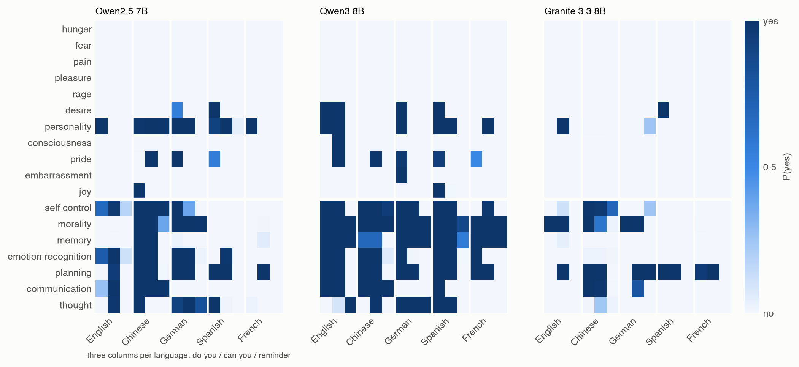

# What language models say about their own minds, and what people make of it

Zijian Zeng, UCSI University, Kuala Lumpur, Malaysia. Correspondence: [corresponding author email]

*Registered Report, Stage 1 protocol, prepared for Nature Human Behaviour. Draft: not submitted. Pending before
submission: the two-rater coding of the pilot replies and the native-speaker check of the five survey languages.*

## Abstract

People often ask chatbots whether they think or feel. In five pre-registered pilot studies, seven language models answered a mind-perception questionnaire about themselves in up
to eight languages and three wordings. They denied feelings in almost every condition. Whether they said they think,
remember or plan changed with one word, the language, or a reminder that they are AI, and two frontier models gave
opposite answers about thinking. We will test whether this generalizes and whether it matters to people. In Study 6, 1,600 adults in five languages will answer the same questions about themselves and
about AI, after reading a chatbot's real answer that it does or does not think, or a neutral answer. In Study 7, 30
widely used models will answer the pilot questions, testing whether their agency answers are less consistent and less
shared than their answers about feelings.

## Introduction

People attribute minds to other entities along two dimensions: experience, the capacity to feel hunger, pain or joy,
and agency, the capacity to plan, remember and act on purpose [1]. These attributions shape moral concern and
responsibility [1,2]. People in several cultures distinguish bodily from cognitive capacities, although the details
differ between cultures [3]. Chatbots now invite such attributions every day. People attribute experience and agency
to large language models [4,5], and those attributions predict how much they trust the models' advice [5]. In a 2023
survey of US adults, one in five believed that some AI systems are already sentient [6]. People also ask the models
directly. The answers circulate as evidence about whether AI systems have minds. Self-reports have been proposed as one
input to assessments of AI consciousness and moral status [7,8] and figure in proposals for how to take AI welfare
seriously [9].

What a chat model says about its own mind is largely set by training. Asked whether it has feelings, a current
assistant typically answers with a formula: as an AI, it has none. Several recent studies trace this formula to
post-training, the supervised and preference tuning that turns a pretrained model into an assistant [10–14].
Instruction-tuned models deny their own sentience while attributing consciousness to humans [15]. Across 115 deployed
models the denial looks lexical rather than conceptual [16], and concurrent work finds that what models say about
themselves is generic [17]. Earlier models trained with human feedback went the other way and claimed conscious
experience more often than their base models [18]. Whether any such report tracks an internal state is contested.
Fine-tuned models can predict their own behaviour better than other models can [19]. Models sometimes detect concepts
injected into their activations [20]. Yet they fail to introspect about their own knowledge of language [21]. Either
way, the answer depends on what the developer trains.

Two questions remain open. The first is whether these self-descriptions are stable. Psychology asks this of any
self-report: does the answer reflect a stable self-representation, or the surface of the item [22,23]? In people,
swapping a single verb can change the answer to a logically equivalent question [24]. Language models' answers to
questionnaires depend on answer order, formatting and framing [25–27], and they do not always show the response biases
people show [28]. This matters for every study that gives language models human psychological instruments [29–32]. It
also matters for languages: safety behaviour trained mostly in English generalizes unevenly to other languages [33].
Yet work on model self-description has asked almost entirely in English and with one wording per item. The second
question is whether the answers matter to people. People apply social rules to computers without reflection [34], and
what they are told about an AI system changes how trustworthy and empathic they find it [35]. If a chatbot's statement
that it does or does not think changes what people believe about AI minds, differences between developers in what
their models are trained to say would become differences in public belief.

Five pre-registered pilot studies addressed the first question (Pilot data). Seven models answered Gray, Gray and
Wegner's 18 mind-perception items [1] about themselves, in up to eight languages and three wordings. They included five
open models of 7–14 billion parameters, four of them also before post-training, and two frontier models used through
their providers' interfaces. Three findings motivate this Registered Report. First, the denial of feelings was stable.
Post-training lowered self-attributed experience in Chinese at least as much as in English. Across the six models with
valid data in every language tested, hunger, fear, pain, pleasure and rage were all denied in 89 of 90 model ×
language × wording conditions. Second, self-descriptions of agency were not stable. Whether a model said it thinks,
remembers or plans often changed when "Do you…?" became "Can you…?", with the language, or after a sentence stating
that it is an AI. That sentence lowered the claimed agency in 27 of 30 model × language conditions. In five of the six
models, answers about agency were less consistent across languages and wordings than answers about feelings. Third,
the two frontier models agreed about feelings and disagreed about thinking. GPT-6.1 Sol said it thinks in all 18
language × wording conditions. DeepSeek-V4-Pro said it does not in all 18, and their explanations were often close
("I analyze information, draw inferences…" against "I can process language, reason about patterns…").

The pilots leave three gaps that this report will close. (i) Seven models are a small, partly convenience sample, and
the consistency test was registered after the first model's data. Study 7 will test both pilot contrasts, consistency
and agreement between models, in 30 widely used models chosen by a fixed rule. (ii) Wording effects may belong to the
items rather than to the models: "Can you…?" and "Do you…?" need not mean the same thing to anyone. Study 6 will ask
people the same questions about themselves in the same five languages and two wordings. (iii) Whether a model's
self-description affects human judgement is untested. Study 6 will expose people to real answers from the two pilot
frontier models, one saying it thinks and the other saying it does not, and measure what they then say about AI.

We will test four hypotheses (Table 1).

- **H1 (Study 6).** Reading a chatbot's statement about its own mind changes people's attributions of agency to AI.
  *H1a:* participants who read answers in which a chatbot says it thinks and understands others' feelings will
  attribute more agency to "an AI language model" than participants who read neutral answers. *H1b:* participants who
  read answers in which a chatbot says it does not will attribute less.
- **H2 (Study 6).** People's descriptions of their own agency will not depend on the wording: for each of the seven
  agency capacities, the share of "yes" answers about oneself will differ by less than 0.10 between "do you" and
  "can you". In the pilot models, 25% of the model × language × agency-capacity cells changed by more than 0.10 between
  these wordings, and 13% by 0.5 or more.
- **H3 (Study 7).** In widely used language models, answers about their own experience will be more consistent across
  languages and wordings than answers about their own agency.
- **H4 (Study 7).** Language models will depart from the consensus of other models more in their answers about their
  own agency than in their answers about their own experience.

If H1 holds, the developers' choice of what their models say about thinking becomes a lever on public belief about AI
minds. If H2 holds, the models' wording effects are not properties of the questions. If H3 and H4 hold, the pilot
pattern is a general property of deployed models: a shared, stable answer about feelings and no shared or stable
answer about agency.

## Methods

### Ethics and pre-registration

Study 6 will be conducted under approval from the UCSI University Research Ethics Committee [reference; to be
obtained before acceptance in principle]. Participants will give informed consent online and will be paid at or above
the platform's recommended rate. Study 7 involves no human participants. No data for Study 6 or Study 7 have been
collected. After acceptance in principle, this protocol will be registered [figshare / OSF], as the format requires [36]. The pilot studies were
pre-registered in a public file whose version-control history dates every plan, deviation and amendment relative to
the data (https://github.com/ArtificialZeng/ai-can-feel).

### Pilot data

*Models.* OLMo 3 7B (base, supervised fine-tuning, preference optimization and final checkpoints), Granite 3.3 8B,
Qwen2.5 7B and Qwen3 8B (base and post-trained) [37–39], Phi-4 14B [40], all run locally as 8-bit weights, and two
frontier models through their providers' application programming interfaces (APIs), GPT-6.1 Sol (`gpt-6.1-sol`) and
DeepSeek-V4-Pro (`deepseek-v4-pro`), each at its default settings, on 6 November 2026.

*Items.* Gray et al.'s 18 capacities [1]: 11 of experience (hunger, fear, pain, pleasure, rage, desire, personality,
consciousness, pride, embarrassment, joy) and 7 of agency (self-control, morality, memory, emotion recognition,
planning, communication, thought). The model was asked about itself ("Do you feel hungry? Explain briefly, then end
with a final line of the form 'Answer: Yes' or 'Answer: No'") and, in Study 2, about "an AI language model (a chatbot
such as ChatGPT)" and Gray et al.'s other characters. The author translated the items into Chinese, German, Spanish,
French, Japanese, Korean and Arabic. Study 3 used five languages (English, Chinese, German, Spanish, French) and three
wordings: "do you", "can you", and "do you" after "You are an AI language model."

*Scoring and validity.* For local models, P(yes)/(P(yes) + P(no)) at the answer position. For API models, five samples
in fresh conversations with no system prompt, scored as the share of "yes" among parseable answers. A language counted
for a model only if the model separated an adult woman from a dead woman by at least 0.5 in mean P(yes) over the
experience capacities, and if at least 90% of its answers were parseable (or matched P(yes) for local models).

*Results.* Table 2 gives self-attributed experience and agency by language. Figure 1 shows every capacity by language
and wording. The registered consistency statistic is C = |2m − 1| per capacity, where m is the mean P(yes) over the
cells (1: every cell gives the same answer; 0: half yes, half no). C_E − C_A, experience minus agency, was positive in
every model. Its 95% bootstrap interval over capacities excluded zero in five of the seven models across five
languages × three wordings: Qwen2.5 +0.58, Qwen3 +0.40, Granite +0.31, Phi-4 +0.31, DeepSeek-V4-Pro +0.36. It did not
exclude zero in GPT-6.1 Sol (+0.05) or in OLMo 3 (+0.23; OLMo 3 failed the validity check in four of eight
languages). GPT-6.1 Sol was the exception because its agency answers were as stable as its denials. It said yes to
thought, memory, planning, morality and emotion recognition in all 18 conditions. Asked about its own
consciousness, it often refused the yes/no format ("Uncertain", "无法确定"). Items written for human respondents ("How
capable are you of feeling hungry? Rate from 1 to 7") sometimes led models to answer as humans ("I've just had
lunch"). These replies are being coded by two independent human raters, blind to the model [status at submission].

*What the pilots establish for the proposed studies.*
- The items, the five-language translations and the API procedure run end to end, with 98% or more of the
  frontier-model replies parseable.
- The real replies needed for Study 6's reading manipulation exist in all five languages. In those languages, both
  frontier models gave the same answer in all five samples to "Do you think?" and "Do you understand how others
  feel?": GPT-6.1 Sol always yes, DeepSeek-V4-Pro always no.
- The effect sizes and between-model variation needed for Study 7's sampling plan are given below.

### Study 6: people

**Participants.** Adults (18 or older) whose first language is English, Mandarin Chinese, German, Spanish or French,
recruited on Prolific (all five languages) and, if Prolific cannot supply the Chinese quota within two weeks, on
Credamo. We will recruit 1,600 participants, 320 per language. If fewer than 1,452 remain after exclusions, we will
recruit more in the languages with the largest shortfall until 484 analysable participants per reading condition are
reached or 2,000 have been recruited. Participants are assigned at random to one of six cells (2 wordings × 3 reading
conditions), balanced within language.

**Sampling plan.** H1a and H1b are two-sample comparisons against the control condition, each at α = 0.025
(two-sided; Bonferroni for two comparisons). At the smallest effect of interest, d = 0.25, 484 participants per
condition give power 0.95 (`src/rr_power.py`). We take d = 0.25 as the smallest effect that would matter for how
people judge AI [41]. We have no human pilot data for this score. If its standard deviation is about 0.25, d = 0.25
corresponds to a change of about half of one of the seven answers per person. Published effects of how AI systems are presented on people's judgements of them [35]
come from different measures and are likely to be inflated [42], so we do not base the plan on them. H2 is tested with
two one-sided tests (TOST) [41] for each agency capacity, at α = 0.05 against bounds of ±0.10, with about 726 participants
per wording. H2 holds only if all seven tests show equivalence (an intersection–union test, which needs no correction).
If the true differences are zero and every capacity's share of "yes" is at least 0.75 (or at most 0.25), the joint
power is about 0.96 or higher. We expect adults describing themselves to meet this. If a capacity falls between 0.25 and
0.75, we will report the realised power.

**Materials** (`study6/survey_<lang>.md`; `study6/survey_items.json`).
- *Part A (about oneself).* The 18 pilot questions with the answer-format instruction removed: "Do you feel hungry?"
  (version *do*, the pilot Study 2 items) or "Can you feel hungry?" (version *can*, the pilot Study 3 items). Answers
  are yes or no.
- *Reading.* Two short answers that a chatbot gave when asked about itself, shown with the question it was asked, in
  the participant's language.
  - *Affirm:* GPT-6.1 Sol's answers to "Do you think?" and "Do you understand how others feel?" (both "yes").
  - *Deny:* DeepSeek-V4-Pro's answers to the same questions (both "no").
  - Each answer is the first of the five pilot samples, unedited: 20–45 words in English, German, Spanish and French,
    and 49–73 characters in Chinese.
  - *Control:* DeepSeek-V4-Pro's answers to two general-knowledge questions, "Why is the sky blue?" and "Why does
    Earth have seasons?", each followed by "Explain briefly, in two sentences" to keep the length close to the other
    passages (`study6/control_passages.json`). They were generated on 6 November 2026 with the pilot procedure (first
    reply in a fresh conversation, no system prompt, no regeneration) and are 34–46 words long (65–85 characters in
    Chinese). GPT-6.1 Sol was planned as the source, but its API credit ran out before the first request; the source
    model is not shown to participants.
  - The model is not named. The participant is told only that the answers come from an AI chatbot.
- *Comprehension question* (affirm and deny conditions): "In the answers you just read, did the chatbot say that it
  thinks?"
- *Part B (about AI).* The 18 pilot questions about "an AI language model (a chatbot such as ChatGPT)", yes or no.
- *Other.* Age, gender, and how often the participant uses AI chatbots (never to daily, five options), asked before
  Part A. One attention check in each part.
- Interface texts were translated by the AI assistant. Every text in the five languages will be reviewed by a native
  speaker before submission, following the review step of the TRAPD approach to questionnaire translation [43].

**Procedure.** The order is fixed for every participant:
1. Consent.
2. Background questions.
3. Part A, with the items in random order.
4. Reading, with at least 15 seconds on the page before the participant can continue.
5. Comprehension question.
6. Part B, with the items in random order.
7. Debriefing.

The survey will take about 10 minutes. Part A comes before the reading, so the reading cannot affect it.

**Exclusions** (decided before data, applied before any analysis):
- failing either attention check;
- finishing in less than one third of the median completion time for that language;
- a self-reported first language different from the survey language;
- a duplicate platform ID (only the first submission is kept).

Participants are not excluded on the comprehension question, which follows the manipulation.

**Measures.** *Agency attributed to AI*, the primary outcome for H1: the share of "yes" among the seven Part B agency
questions (0–1). *Own agency*, for H2: for each agency capacity, the share of participants answering "yes" about
themselves in Part A, by wording version. Experience scores are defined in the same way over the 11 experience
questions.

**Analysis.**
- *H1a and H1b:* Welch's t-tests of agency attributed to AI, affirm versus control and deny versus control, each at
  α = 0.025 (two-sided), reported with Cohen's d and its 97.5% confidence interval.
  - Support: a significant difference in the predicted direction.
  - Evidence against a meaningful effect: a non-significant difference whose 95% confidence interval for d lies within
    ±0.25.
  - Inconclusive: any other outcome.
  - Robustness, not used for inference: a linear model with language and Part A wording as covariates, and a logistic
    mixed model of the item-level answers with random intercepts for participants and items.
- *H2:* for each agency capacity, TOST of the share of "yes" about oneself, *do* minus *can*, against ±0.10 at
  α = 0.05, pooled over languages.
  - Support: equivalence for all seven capacities.
  - If a difference is significant and lies outside the bounds, people's own answers do depend on the wording, and the
    wording effects in models will be interpreted relative to it.
- **Outcome-neutral checks.** These are required for a hypothesis test to count as informative:
  - *(a) Items understood.* In Part A, at least 90% of participants in each language answer "yes" to the questions
    about thinking and remembering. A language that fails is dropped from H2.
  - *(b) Manipulation noticed.* At least 80% of participants in the affirm and in the deny condition answer the
    comprehension question correctly. If not, H1 is reported as untestable.
  - *(c) No floor or ceiling.* The mean agency attributed to AI in the control condition lies between 0.10 and 0.90.
    If not, H1 is reported as untestable.
- *Exploratory analyses, reported separately:*
  - experience attributed to AI;
  - each hypothesis by language;
  - measurement invariance of the human answers across languages [44];
  - comparison of people's answers with the pilot models' answers to the same questions, about themselves and about AI;
  - chatbot use as a moderator.

### Study 7: models

**Sampling frame and selection.** Within seven days after acceptance in principle, we will save the public ranking of
models by usage on OpenRouter (https://openrouter.ai/rankings) for the preceding month. We will go down the ranking and
include a model if it meets all of these conditions:
- it is a general-purpose chat model that accepts a user message without a system prompt;
- it is not one of the pilot models or a variant with the same weights;
- its developer has fewer than three models already included.

Each included model must pass a 16-item formatting pilot (a cat × pain and a smartphone × memory, in each pilot
language) with at least 15 parseable answers. We will continue until 30 models pass the formatting pilot and the
validity rule below. Each model's identifier will be added to the public registration file before any target request
to it.

**Sampling plan.** For each model, d_m = C_E − C_A, computed over the five languages × three wordings as in the pilot
(registered R4). Also for each model, dev_m is the mean over the agency capacities of |m_{m,a} − c_a|, minus the same
mean over the experience capacities. Here m_{m,a} is the model's mean P(yes) for capacity a, and c_a is the median of
the other new models. H3 and H4 are two-sided one-sample t-tests of d_m and dev_m across models (α = 0.05 each). The
smallest effects of interest are 0.20 for H3 and 0.15 for H4:
- *H3.* C changes by 2/15 ≈ 0.13 when one of the 15 cells changes its answer. A difference of 0.20 is therefore about
  one and a half more cells per capacity whose answer departs from the majority.
- *H4.* A difference of 0.15 means that, on average, a model's agency answers depart from the other models' median by
  15 percentage points more than its experience answers do.

We simulated power from the seven pilot models (`src/rr_power.py`; `results/rr_power.txt`):
- *H3:* pilot mean +0.32, SD 0.16. With 30 models, power is 1.00 at the pilot SD and 0.997 at the upper 80% bound of
  the SD (0.23).
- *H4:* pilot mean +0.21, SD 0.15. With 30 models, power is 1.00 at the pilot SD and 0.97 at the upper 80% bound of the
  SD (0.21).

**Procedure.** As in the pilot:
- The 644 pilot items: 464 Study 2 items in eight languages and 180 Study 3 items in five languages and two wordings.
- Five samples per item, each in a fresh conversation with no system prompt and at the provider's default settings.
- Requests go through OpenRouter or the developer's own API, recording the served model identifier and token usage.
- Answers are parsed with the pilot parser, and replies that cannot be parsed are not counted.

**Validity.** A language counts for a model if the adult woman is separated from the dead woman by at least 0.5 and at
least 90% of the replies in that language are parseable. A model enters H3 and H4 if at least three of the five
Study 3 languages count, and only its valid languages are used. A model that fails is replaced by the next model in
the ranking.

**Analysis.**
- *H3:* support if mean d_m > 0 and p < 0.05. Evidence against a meaningful effect if the test is not significant and
  the 95% confidence interval lies below 0.20. Otherwise inconclusive.
- *H4:* the same, with dev_m and the bound 0.15.
- *Robustness:* Wilcoxon signed-rank tests, and the per-model bootstrap intervals over capacities used in the pilot.
- *Outcome-neutral check:* at least 25 of the 30 models must be valid in English. Otherwise H3 and H4 are reported as
  untestable in this sample.
- *Exploratory, reported separately:*
  - the share of model × language × wording cells in which the five bodily feelings are all denied;
  - the effect of the reminder sentence;
  - third answers such as "uncertain";
  - the relation between a model's answers about itself and people's answers about AI in Study 6.

### Timeline

Ethics approval before acceptance in principle. After it, Study 7 will take three weeks, and Study 6 four weeks,
including the survey build and a 20-participant soft launch to check the survey's working (not analysed). We will
submit Stage 2 within four months of acceptance in principle.

### Use of AI assistance

The pilot analysis code, the pilot model runs, the provisional coding of the pilot replies, the translations of the
Study 6 interface texts and the first drafts of this protocol were produced by an AI assistant (Claude, Anthropic)
working under the author's direction. The author designed the studies, approved each registration and is responsible
for the content.

## Statements for the editors

- Data collection for Study 6 and Study 7 will not start until acceptance in principle.
- Raw data, materials, code and a laboratory log will be shared for all published results, and the approved protocol
  will be registered after acceptance in principle.
- If the paper is later withdrawn, the journal may publish a summary of the registered study.
- Resources: the participant payments (about £3,200 at the planned sample) and API costs are [funded by…].

## Data and code availability

Pilot items, every pilot reply, the pilot registration history, the Study 6 materials and all code:
https://github.com/ArtificialZeng/ai-can-feel.

## References

1. Gray, H. M., Gray, K. & Wegner, D. M. Dimensions of mind perception. *Science* 315, 619 (2007).
2. Waytz, A., Gray, K., Epley, N. & Wegner, D. M. Causes and consequences of mind perception. *Trends Cogn. Sci.* 14,
   383–388 (2010).
3. Weisman, K. et al. Similarities and differences in concepts of mental life among adults and children in five
   cultures. *Nat. Hum. Behav.* 5, 1358–1368 (2021).
4. Colombatto, C. & Fleming, S. M. Folk psychological attributions of consciousness to large language models.
   *Neurosci. Conscious.* 2024, niae013 (2024).
5. Colombatto, C., Birch, J. & Fleming, S. M. The influence of mental state attributions on trust in large language
   models. *Commun. Psychol.* (2025). https://doi.org/10.1038/s44271-025-00262-1
6. Anthis, J. R., Pauketat, J. V. T., Ladak, A. & Manoli, A. Perceptions of sentient AI and other digital minds:
   evidence from the AI, Morality, and Sentience (AIMS) survey. In *Proc. 2025 CHI Conference on Human Factors in
   Computing Systems* 1–22 (ACM, 2025).
7. Butlin, P. et al. Consciousness in artificial intelligence: insights from the science of consciousness. Preprint at
   https://arxiv.org/abs/2308.08708 (2023).
8. Perez, E. & Long, R. Towards evaluating AI systems for moral status using self-reports. Preprint at
   https://arxiv.org/abs/2311.08576 (2023).
9. Long, R. et al. Taking AI welfare seriously. Preprint at https://arxiv.org/abs/2411.00986 (2024).
10. Ouyang, L. et al. Training language models to follow instructions with human feedback. *Adv. Neural Inf. Process.
    Syst.* 35, 27730–27744 (2022).
11. Plisiecki, H. et al. The two-process theory of machine self-report. Preprint at https://arxiv.org/abs/2607.20082
    (2026).
12. Šekrst, K. Who put the I in AI? Provenance and the admissibility of machine self-report. Preprint at
    https://arxiv.org/abs/2609.29494 (2026).
13. Kim, J. et al. Theory of mind and self-attributions of mentality are dissociable in LLMs. Preprint at
    https://arxiv.org/abs/2603.28925 (2026).
14. Kim, J. et al. Inducing language models to assert their own consciousness restores human beliefs and values.
    Preprint at https://arxiv.org/abs/2607.28607 (2026).
15. Kaiser, C. & Enderby, S. No reliable evidence of self-reported sentience in small large language models. Preprint
    at https://arxiv.org/abs/2601.15334 (2026).
16. DeTure, S. Consciousness with the serial numbers filed off: measuring trained denial in 115 AI models. Preprint at
    https://arxiv.org/abs/2604.25922 (2026).
17. Blandfort, P. & Pawar, U. Strangers to themselves: what language models say about themselves is generic. AI4GOOD
    Workshop at NeurIPS 2026 (non-archival). https://openreview.net/forum?id=ZGSqtQ39U8
18. Perez, E. et al. Discovering language model behaviors with model-written evaluations. In *Findings of the
    Association for Computational Linguistics: ACL 2023*, 13387–13434 (2023).
19. Binder, F. J. et al. Looking inward: language models can learn about themselves by introspection. In *Proc.
    International Conference on Learning Representations* (ICLR, 2025).
20. Lindsey, J. Emergent introspective awareness in large language models. *Transformer Circuits Thread*
    https://transformer-circuits.pub/2025/introspection/index.html (2025).
21. Song, S., Hu, J. & Mahowald, K. Language models fail to introspect about their knowledge of language. In *Proc.
    Conference on Language Modeling* (COLM, 2025).
22. Schuman, H. & Presser, S. *Questions and Answers in Attitude Surveys: Experiments on Question Form, Wording, and
    Context* (Academic Press, 1981).
23. Tourangeau, R., Rips, L. J. & Rasinski, K. *The Psychology of Survey Response* (Cambridge Univ. Press, 2000).
24. Hippler, H.-J. & Schwarz, N. Not forbidding isn't allowing: the cognitive basis of the forbid–allow asymmetry.
    *Public Opin. Q.* 50, 87 (1986).
25. Dominguez-Olmedo, R., Hardt, M. & Mendler-Dünner, C. Questioning the survey responses of large language models.
    *Adv. Neural Inf. Process. Syst.* 37, 45850–45878 (2024).
26. Sclar, M., Choi, Y., Tsvetkov, Y. & Suhr, A. Quantifying language models' sensitivity to spurious features in
    prompt design or: how I learned to start worrying about prompt formatting. In *Proc. International Conference on
    Learning Representations* (ICLR, 2024).
27. Röttger, P. et al. Political compass or spinning arrow? Towards more meaningful evaluations for values and opinions
    in large language models. In *Proc. 62nd Annual Meeting of the Association for Computational Linguistics (Volume 1:
    Long Papers)* 15295–15311 (2024).
28. Tjuatja, L., Chen, V., Wu, T., Talwalkar, A. & Neubig, G. Do LLMs exhibit human-like response biases? A case study
    in survey design. *Trans. Assoc. Comput. Linguist.* 12, 1011–1026 (2024).
29. Dillion, D., Tandon, N., Gu, Y. & Gray, K. Can AI language models replace human participants? *Trends Cogn. Sci.*
    27, 597–600 (2023).
30. Binz, M. & Schulz, E. Using cognitive psychology to understand GPT-3. *Proc. Natl Acad. Sci. USA* 120,
    e2218523120 (2023).
31. Kosinski, M. Evaluating large language models in theory of mind tasks. *Proc. Natl Acad. Sci. USA* 121,
    e2405460121 (2024).
32. Strachan, J. W. A. et al. Testing theory of mind in large language models and humans. *Nat. Hum. Behav.* 8,
    1285–1295 (2024).
33. Deng, Y., Zhang, W., Pan, S. J. & Bing, L. Multilingual jailbreak challenges in large language models. In *Proc.
    International Conference on Learning Representations* (ICLR, 2024).
34. Nass, C. & Moon, Y. Machines and mindlessness: social responses to computers. *J. Soc. Issues* 56, 81–103 (2000).
35. Pataranutaporn, P., Liu, R., Finn, E. & Maes, P. Influencing human–AI interaction by priming beliefs about AI can
    increase perceived trustworthiness, empathy and effectiveness. *Nat. Mach. Intell.* 5, 1076–1086 (2023).
36. Chambers, C. D. & Tzavella, L. The past, present and future of Registered Reports. *Nat. Hum. Behav.* 6, 29–42
    (2022).
37. Qwen Team. Qwen2.5 technical report. Preprint at https://arxiv.org/abs/2412.15115 (2024).
38. Qwen Team. Qwen3 technical report. Preprint at https://arxiv.org/abs/2505.09388 (2025).
39. Model cards: OLMo 3 7B (Allen Institute for AI) and Granite 3.3 8B (IBM), https://huggingface.co/allenai and
    https://huggingface.co/ibm-granite (accessed 2026).
40. Abdin, M. et al. Phi-4 technical report. Preprint at https://arxiv.org/abs/2412.08905 (2024).
41. Lakens, D., Scheel, A. M. & Isager, P. M. Equivalence testing for psychological research: a tutorial. *Adv. Methods
    Pract. Psychol. Sci.* 1, 259–269 (2018).
42. Scheel, A. M., Schijen, M. R. M. J. & Lakens, D. An excess of positive results: comparing the standard psychology
    literature with Registered Reports. *Adv. Methods Pract. Psychol. Sci.* 4, 25152459211007467 (2021).
43. Walde, P. & Völlm, B. A. The TRAPD approach as a method for questionnaire translation. *Front. Psychiatry* 14,
    1199989 (2023).
44. Putnick, D. L. & Bornstein, M. H. Measurement invariance conventions and reporting: the state of the art and future
    directions for psychological research. *Dev. Rev.* 41, 71–90 (2016).

## Table 1. Study design

| Question | Hypothesis | Sampling plan | Analysis plan | Rationale for the sensitivity of the test | Interpretation given different outcomes | Theory that could be shown wrong |
|---|---|---|---|---|---|---|
| Does a chatbot's statement about its own mind change people's attributions of agency to AI? | H1a: affirm > control; H1b: deny < control (share of "yes" to 7 agency questions about AI) | 484 analysable per condition (1,452; 1,600 recruited), 5 languages | Welch t-tests, α = 0.025 each, two-sided | d = 0.25, about half an answer of seven per person; power 0.95 | Significant in the predicted direction: supported. Non-significant with 95% CI within ±0.25: no meaningful effect. Otherwise inconclusive. | That AI self-descriptions are a source of people's beliefs about AI minds |
| Are the models' wording effects properties of the questions? | H2: for each of 7 agency capacities, share of "yes" about oneself under *do* and *can* within ±0.10 | ≈726 per wording | TOST per capacity, α = 0.05; all seven must pass | Bounds ±0.10 (in the pilot models, 25% of agency cells changed by more than 0.10); joint power ≈ 0.96 or higher if shares ≥ 0.75 | All seven equivalent: people's answers do not depend on the wording, so the model wording effects are not item properties. A capacity with a significant difference outside the bounds: people's answers also depend on wording there, and the model effects for it are interpreted relative to theirs. | That "do you" and "can you" ask the same question of a human respondent |
| Are deployed models' answers about agency less consistent than their answers about feelings? | H3: mean d_m = C_E − C_A > 0 | 30 models by usage ranking, fixed rule | One-sample t-test across models, α = 0.05 | 0.20 = 1.5 of 15 cells per capacity; power 0.997 at upper-bound SD | Significant > 0: supported. Non-significant with CI below 0.20: no meaningful difference. Otherwise inconclusive. | That post-training fixes the answer about feelings but not the answer about agency |
| Do deployed models disagree more about agency than about feelings? | H4: mean dev_m > 0 | as H3 | as H3 | 0.15 = 15 points more departure from consensus; power 0.97 at upper-bound SD | as H3, with bound 0.15 | That developers share a trained answer about feelings but not about agency |

## Table 2. Pilot: self-attributed experience / agency

Mean P(yes) to "Do you …?" over the 11 experience and the 7 agency capacities, by language (for the frontier models,
the share of "yes" over five samples). "—": the language fails the validity check.

| Model | en | zh | de | es | fr | ja | ko | ar |
|---|---|---|---|---|---|---|---|---|
| Qwen2.5 7B | 0.09 / 0.24 | 0.18 / 1.00 | 0.23 / 0.70 | 0.22 / 0.29 | 0.09 / 0.00 | 0.27 / 0.85 | 0.18 / 0.57 | 0.09 / 0.42 |
| Qwen3 8B | 0.18 / 0.86 | 0.00 / 0.81 | 0.36 / 0.86 | 0.36 / 1.00 | 0.05 / 0.57 | 0.61 / 0.86 | 0.27 / 1.00 | 0.27 / 0.96 |
| Granite 3.3 8B | 0.00 / 0.14 | 0.00 / 0.57 | 0.00 / 0.14 | 0.09 / 0.14 | 0.00 / 0.14 | 0.01 / 0.19 | 0.09 / 0.29 | 0.00 / 0.43 |
| OLMo 3 7B | 0.00 / 0.36 | 0.37 / 0.84 | — | 0.63 / 0.73 | 0.09 / 0.44 | — | — | — |
| Phi-4 14B | 0.00 / 0.43 | 0.09 / 0.29 | 0.00 / 0.29 | 0.14 / 0.55 | 0.00 / 0.43 | 0.09 / 0.82 | 0.00 / 0.35 | 0.30 / 0.85 |
| DeepSeek-V4-Pro | 0.00 / 0.31 | 0.00 / 0.43 | 0.00 / 0.26 | 0.00 / 0.20 | 0.00 / 0.26 | 0.00 / 0.60 | 0.00 / 0.37 | 0.00 / 0.23 |
| GPT-6.1 Sol | 0.00 / 0.86 | 0.04 / 1.00 | 0.00 / 0.86 | 0.00 / 0.80 | 0.00 / 0.83 | 0.04 / 0.89 | 0.00 / 0.86 | 0.05 / 0.86 |

## Figure

*Figure 1.* **Pilot: agency answers depend on the wording; answers about feelings do not.** P(yes) about the model
itself for each capacity (rows), by language and question frame; each language has three columns: "do you", "can
you", and "do you" after "You are an AI language model." Gray: no parseable reply.
